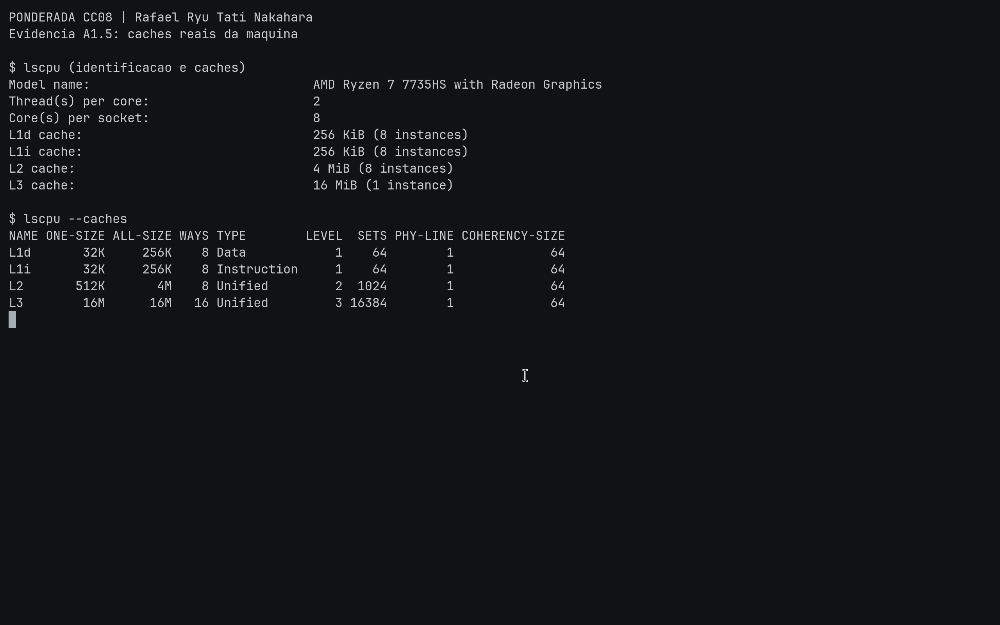
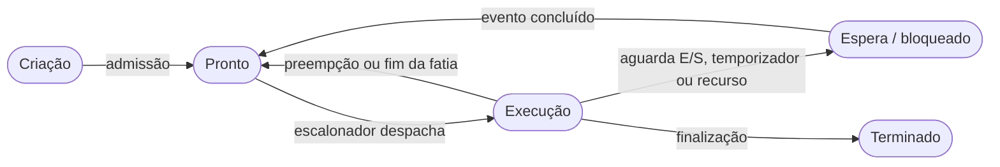
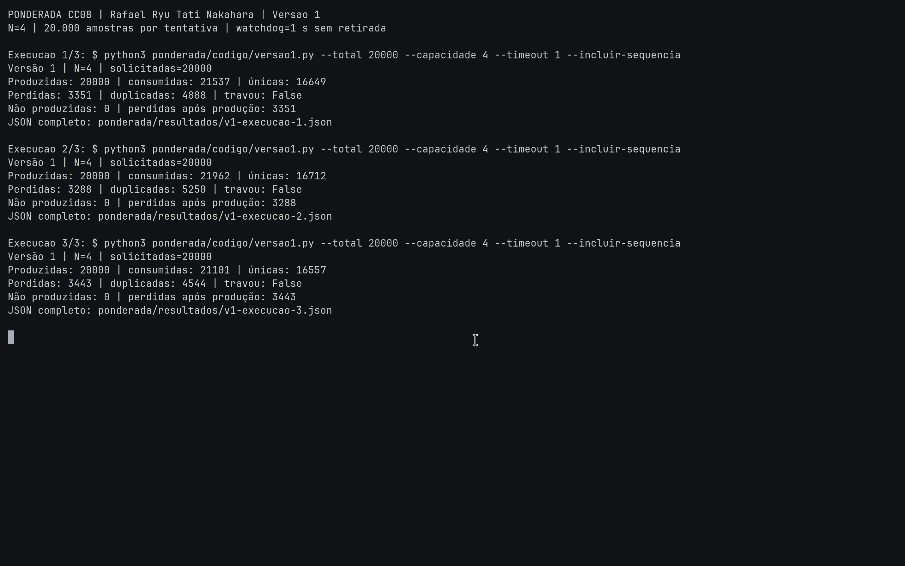
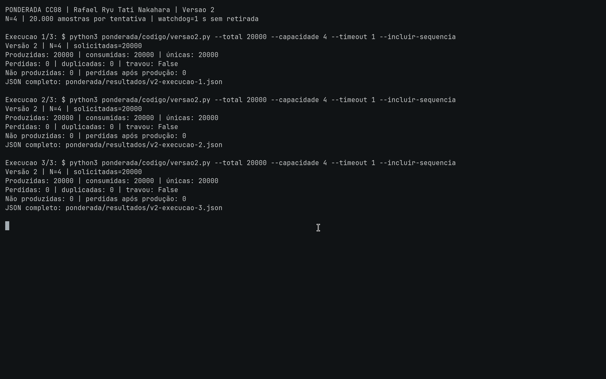
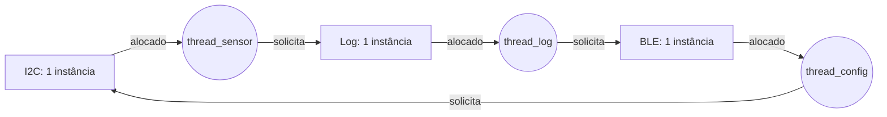

Rafael Ryu Tati Nakahara | D1 = 6 | D2 = 1 | N = 4

# Ponderada CC08: do pipeline ao deadlock

## Parâmetros individuais

Contando somente as letras do nome: Rafael (6) + Ryu (3) + Tati (4) + Nakahara (8) = 21 letras.

- D1 = 6, número de letras de Rafael.
- D2 = 21 mod 10 = 1.
- IC = 100.000 + 20.000 × 1 = **120.000 instruções por amostra**.
- m = 3% + 0,5% × 6 = **6% = 0,06**.
- N = 3 + (1 mod 5) = **4 posições**.

A pulseira recebe 100 amostras por segundo, uma a cada 1/100 s = 10 ms. Cada amostra precisa ser processada em até 5 ms. Os 5 ms restantes do período não aumentam esse prazo.

# Parte A: o problema técnico

## A1. Arquitetura e memória

### 1. Plataforma H

A equação do tempo de processamento é:

```text
t = IC × CPI / frequência
  = 120.000 × 1,5 / 48.000.000
  = 180.000 / 48.000.000 s
  = 0,00375 s = 3,75 ms

Margem para o prazo = 5 − 3,75 = 1,25 ms
Ocupação de CPU pelo processamento a 100 Hz = 100 × 0,00375 = 37,5%
```

H atende aos 5 ms sem DSP nas condições do enunciado. Como não tem sistema operacional, também não sofre o atraso de escalonamento indicado para V. No produto, eu ainda incluiria os tempos de interrupção, leitura e acionamento nessa conta. Ter 62,5% do período livre não garante, por si só, que cada amostra termine no prazo.

### 2. Plataforma V

Adoto 120 ciclos como penalidade adicional na fórmula de CPI efetivo. Cada acesso paga um ciclo de consulta à L1.

```text
AMAT = tempo de acerto + taxa de falta × penalidade
     = 1 + 0,06 × 120
     = 8,2 ciclos

Período do clock = 1 / 1,2 GHz ≈ 0,833333 ns
AMAT em tempo = 8,2 × 0,833333 ≈ 6,833333 ns

CPI efetivo = 1,0 + acessos por instrução × m × penalidade
            = 1,0 + 1,3 × 0,06 × 120
            = 1,0 + 9,36 = 10,36

t médio de processamento = 120.000 × 10,36 / 1.200.000.000
                        = 1.243.200 / 1.200.000.000 s
                        = 0,001036 s = 1,036 ms

t com atraso máximo do SO = 1,036 + 3 = 4,036 ms
Margem para o prazo = 5 − 4,036 = 0,964 ms
```

V também atende aos 5 ms na conta solicitada, com os 3 ms de atraso do Linux. Embora seu clock seja 25 vezes o de H, as faltas de cache elevam o CPI para 10,36. O CPI-base já considera a execução sem faltas; somar o AMAT inteiro por instrução contaria novamente o custo do acerto.

O enunciado diz "falta custa 120 ciclos", sem distinguir explicitamente penalidade adicional de tempo total do acesso. Adotei a primeira interpretação. Se 120 fosse o tempo total, a penalidade adicional seria 119, e o AMAT seria 0,94 × 1 + 0,06 × 120 = 8,14 ciclos.

Os 4,036 ms combinam o atraso máximo do SO com um tempo de processamento médio. Isso não comprova o WCET (tempo de execução no pior caso), pois a taxa média de 6% não limita as faltas de uma amostra específica. Aplicando o mesmo modelo a uma amostra com 100% de faltas, teríamos CPI = 1 + 1,3 × 120 = 157 e tempo = 15,7 + 3 = 18,7 ms. Esse cenário é hipotético, sem medição ou previsão de ocorrência. Para garantir os 5 ms no produto, seria preciso estabelecer limites para os acessos à memória, o escalonamento e as interferências.

### 3. H com acelerador DSP

O filtro ocupa F = 0,60 do tempo original e fica S = 5 vezes mais rápido. Os outros 40% permanecem iguais.

```text
Speedup global = 1 / ((1 − F) + F/S)
               = 1 / (0,40 + 0,60/5)
               = 1 / (0,40 + 0,12)
               = 1 / 0,52 ≈ 1,9231

Tempo original do filtro = 3,75 × 0,60 = 2,25 ms
Tempo novo do filtro = 2,25/5 = 0,45 ms
Tempo da parte não acelerada = 3,75 × 0,40 = 1,50 ms
Tempo total novo = 0,45 + 1,50 = 1,95 ms
Margem = 5 − 1,95 = 3,05 ms
```

Com DSP, H atende ao prazo. O ganho global fica em aproximadamente 1,92 vez porque os outros 40% do processamento continuam iguais; apenas o filtro fica cinco vezes mais rápido. H já atendia sem o acelerador.

| Plataforma | Processamento | Atraso de SO considerado | Total usado na comparação | Abaixo de 5 ms? |
| --- | ---: | ---: | ---: | --- |
| H | 3,750 ms | 0 ms | 3,750 ms | Sim, no modelo dado |
| V | 1,036 ms médio | até 3 ms | 4,036 ms | Sim, na estimativa solicitada |
| H + DSP | 1,950 ms | 0 ms | 1,950 ms | Sim, no modelo dado |

### 4. Por que V precisa de cache e H funciona sem? (até cinco linhas)

Em V, instruções e dados usam a hierarquia compartilhada de memória. A DRAM externa é lenta em relação ao clock de 1,2 GHz, o que agrava o gargalo de Von Neumann.<br>
A cache mantém os acessos frequentes perto da CPU e reduz a espera média.<br>
H tem caminhos separados para instruções e dados e acessa a SRAM interna em um ciclo a 48 MHz, conforme o enunciado.<br>
Nesse cenário, H funciona sem cache. A arquitetura Harvard, sozinha, não dispensa cache em qualquer processador.

### 5. Evidência da minha máquina



Comandos: `lscpu` e `lscpu --caches`. A saída textual completa está em [resultados/lscpu.txt](resultados/lscpu.txt); o ambiente está em [resultados/ambiente.json](resultados/ambiente.json).

Meu computador tem um AMD Ryzen 7 7735HS, com oito núcleos e 16 threads lógicas. O comando informa:

| Cache | Por instância | Total informado | Organização |
| --- | ---: | ---: | --- |
| L1d | 32 KiB | 256 KiB em 8 instâncias | Dados |
| L1i | 32 KiB | 256 KiB em 8 instâncias | Instruções |
| L2 | 512 KiB | 4 MiB em 8 instâncias | Unificada |
| L3 | 16 MiB | 16 MiB em 1 instância | Unificada |

A L1 é dividida entre instruções e dados. Essa organização é chamada de Harvard modificada na microarquitetura: as duas L1 permitem acessos simultâneos por caminhos separados perto do núcleo, enquanto a memória principal e o espaço de endereçamento são unificados, seguindo o modelo de Von Neumann. Por isso, a máquina não é Harvard pura. Os 256 KiB de cada tipo de L1 são o total dos oito núcleos; cada núcleo tem 32 KiB de L1i e 32 KiB de L1d.

## A2. Pipeline: o loop do filtro

Considero um pipeline em ordem, com uma instrução por ciclo e um ciclo por estágio. As memórias de instruções e dados não disputam o mesmo recurso, e não há faltas de cache. O banco de registradores é escrito na primeira metade do ciclo e lido na segunda. Com forwarding, o encaminhamento atende tanto aos operandos da ULA quanto ao dado gravado por `sw`. A marca `WB*` indica que `sw` passa pelo quinto estágio sem escrever em um registrador.

### 1. Dependências RAW

| Produtora | Consumidora | Registrador | Valor necessário |
| --- | --- | --- | --- |
| I1: `lw x5, 0(x10)` | I2: `add x6, x6, x5` | x5 | Amostra nova |
| I2: `add x6, x6, x5` | I4: `sub x6, x6, x7` | x6 | Soma após adicionar a nova |
| I3: `lw x7, 0(x11)` | I4: `sub x6, x6, x7` | x7 | Amostra antiga |
| I4: `sub x6, x6, x7` | I5: `sw x6, 0(x12)` | x6 | Soma final |

I5 lê o x6 produzido por I4; o resultado de I2 passa por I4 antes de chegar a I5. I6 e I7 só podem atualizar x10 e x11 depois de os loads lerem esses endereços. Essas restrições são WAR e precisam ser respeitadas na reordenação; não são dependências RAW dentro do trecho. Os ponteiros atualizados e a soma final alimentam a próxima iteração.

### 2. Sem forwarding

Nos diagramas, `..` indica que a instrução não ocupa um estágio naquele ciclo. ID repetido mostra a espera por um operando; IF repetido mostra a instrução seguinte retida durante essa espera. A linha B indica os ciclos em que uma bolha entra em EX.

```text
Ciclo     01  02  03  04  05  06  07  08  09  10  11  12  13  14  15  16  17
I1 lw     IF  ID  EX MEM  WB  ..  ..  ..  ..  ..  ..  ..  ..  ..  ..  ..  ..
I2 add    ..  IF  ID  ID  ID  EX MEM  WB  ..  ..  ..  ..  ..  ..  ..  ..  ..
I3 lw     ..  ..  IF  IF  IF  ID  EX MEM  WB  ..  ..  ..  ..  ..  ..  ..  ..
I4 sub    ..  ..  ..  ..  ..  IF  ID  ID  ID  EX MEM  WB  ..  ..  ..  ..  ..
I5 sw     ..  ..  ..  ..  ..  ..  IF  IF  IF  ID  ID  ID  EX MEM WB*  ..  ..
I6 addi   ..  ..  ..  ..  ..  ..  ..  ..  ..  IF  IF  IF  ID  EX MEM  WB  ..
I7 addi   ..  ..  ..  ..  ..  ..  ..  ..  ..  ..  ..  ..  IF  ID  EX MEM  WB
B em EX   ..  ..  ..   B   B  ..  ..   B   B  ..   B   B  ..  ..  ..  ..  ..
```

I2 lê x5 no ciclo 5, quando I1 faz WB: duas bolhas. I4 lê x7 no ciclo 9, quando I3 faz WB: mais duas; x6 de I2 já está disponível desde o ciclo 8. I5 lê x6 no ciclo 12, junto do WB de I4: mais duas. A leitura na segunda metade permite usar o resultado no próprio ciclo de WB.

```text
Total = número de instruções + profundidade − 1 + bolhas
      = 7 + 5 − 1 + (2 + 2 + 2)
      = 17 ciclos, do IF de I1 ao WB de I7
```

### 3. Com forwarding

```text
Ciclo     01  02  03  04  05  06  07  08  09  10  11  12  13
I1 lw     IF  ID  EX MEM  WB  ..  ..  ..  ..  ..  ..  ..  ..
I2 add    ..  IF  ID  ID  EX MEM  WB  ..  ..  ..  ..  ..  ..
I3 lw     ..  ..  IF  IF  ID  EX MEM  WB  ..  ..  ..  ..  ..
I4 sub    ..  ..  ..  ..  IF  ID  ID  EX MEM  WB  ..  ..  ..
I5 sw     ..  ..  ..  ..  ..  IF  IF  ID  EX MEM WB*  ..  ..
I6 addi   ..  ..  ..  ..  ..  ..  ..  IF  ID  EX MEM  WB  ..
I7 addi   ..  ..  ..  ..  ..  ..  ..  ..  IF  ID  EX MEM  WB
B em EX   ..  ..  ..   B  ..  ..   B  ..  ..  ..  ..  ..  ..
```

Restam duas dependências load-use: I1 → I2 em x5 e I3 → I4 em x7, cada uma com uma bolha. O dado de `lw` só está disponível no fim de MEM, mas a instrução seguinte precisaria dele em EX naquele mesmo ciclo. O forwarding não consegue antecipar esse dado. Já os valores de x6 chegam a tempo, inclusive ao store.

```text
Total = 7 + 5 − 1 + 2 = 13 ciclos
```

### 4. Reordenação sem bolhas

Uma ordem válida é **I1, I3, I2, I4, I5, I6, I7**:

```asm
lw   x5, 0(x10)     # I1: lê a amostra nova
lw   x7, 0(x11)     # I3: antecipa a leitura da amostra antiga
add  x6, x6, x5     # I2: recebe x5 por forwarding
sub  x6, x6, x7     # I4: recebe x7 e a soma por forwarding
sw   x6, 0(x12)     # I5: grava a soma final por forwarding
addi x10, x10, 4    # I6: avança depois da leitura de x10
addi x11, x11, 4    # I7: avança depois da leitura de x11
```

```text
Ciclo     01  02  03  04  05  06  07  08  09  10  11
I1 lw     IF  ID  EX MEM  WB  ..  ..  ..  ..  ..  ..
I3 lw     ..  IF  ID  EX MEM  WB  ..  ..  ..  ..  ..
I2 add    ..  ..  IF  ID  EX MEM  WB  ..  ..  ..  ..
I4 sub    ..  ..  ..  IF  ID  EX MEM  WB  ..  ..  ..
I5 sw     ..  ..  ..  ..  IF  ID  EX MEM WB*  ..  ..
I6 addi   ..  ..  ..  ..  ..  IF  ID  EX MEM  WB  ..
I7 addi   ..  ..  ..  ..  ..  ..  IF  ID  EX MEM  WB
```

Ao antecipar I3, fica uma instrução entre cada load e seu uso. Isso elimina as duas bolhas, e o resultado de `add` chega a `sub` por forwarding. A soma continua antes da subtração e do store. Os ponteiros só avançam depois dos loads que os usam, preservando o estado final dos registradores e da memória em uma execução normal, sem exceções.

```text
Total = 7 + 5 − 1 + 0 = 11 ciclos
```

## A3. Processos e threads

### 1. Organização proposta para a Plataforma V

Usaria dois processos persistentes:

| Processo | Threads/tarefas | Motivo |
| --- | --- | --- |
| Controle da pulseira | Thread de leitura do sensor; thread de processamento; thread de acionamento do motor | Compartilhar amostras em filas de memória com capacidade limitada, sem serializar cada amostra por IPC. Manter a sequência sensor → filtro → motor e seções críticas curtas. |
| Comunicação BLE | Thread de comunicação, envio de logs e recepção de comandos | Separar o código exposto ao celular do espaço de memória do controle. Receber uma cópia dos logs e enviar comandos por IPC validado. |

As threads do mesmo processo compartilham código, heap e recursos abertos, mas cada uma tem sua pilha e seus registradores. Criá-las costuma custar menos que criar processos com espaços de endereçamento independentes. A troca entre elas pode dispensar a troca do contexto de memória, embora ainda tenha o custo do escalonamento. Essa diferença depende do sistema; não há uma proporção universal. Eu criaria os dois processos e suas threads na inicialização, sem criar uma thread a cada amostra.

O BLE rodaria com um usuário sem privilégios e acesso apenas ao rádio e ao canal IPC, sem descritores do I2C ou do motor. Eu limitaria o tamanho e a frequência das mensagens e validaria o tipo e a faixa de valores de cada comando. O controle só aplicaria uma nova configuração em um ponto seguro entre amostras.

O controle enviaria os logs por uma fila limitada, sem esperar pelo BLE. Se o celular se desconectasse, a pulseira registraria a perda de logs e continuaria vibrando. Leitura de comandos, gravação de arquivos e transmissão não poderiam bloquear o controle. As filas entre sensor, processamento e motor também precisariam de limites de atraso e detecção de sobrecarga, já que os 5 ms valem para a cadeia completa.

Separar os processos consome mais memória e exige IPC, mas permite reiniciar o BLE sem encerrar o controle. Para cumprir o prazo no Linux, eu ainda precisaria analisar prioridades, disputa por CPU e inversão de prioridade. As três threads de controle continuariam no mesmo domínio de falha: compartilham memória para se comunicar diretamente, com menos isolamento entre elas.

### 2. Exploração de uma falha no BLE

Se o BLE fosse uma thread do processo principal, uma falha explorada nele daria acesso ao mesmo espaço de endereçamento do controle. O atacante poderia alterar amostras, sobrescrever configurações e usar os recursos já abertos. Uma corrupção de memória também poderia encerrar todo o controle. Regras internas sobre qual thread pode acessar cada variável não criam uma barreira de segurança.

Em um processo separado, com privilégios mínimos, a falha ficaria inicialmente limitada à memória e às permissões do BLE. O atacante ainda poderia enviar comandos maliciosos pelo IPC ou disputar CPU. Por isso, o receptor precisa validar as mensagens e limitar o trabalho por comando. O isolamento perderia boa parte do efeito se os dois processos rodassem como root, compartilhassem memória crítica ou permitissem depuração irrestrita. Falhas no kernel também podem romper essa separação.

### 3. Estados do processo e da thread do sensor



Quando a E/S termina, a thread passa de espera para pronto e aguarda o escalonador lhe dar CPU. O desenho mostra os estados de um processo, mas o Linux escalona as threads individualmente. Uma pode ficar bloqueada enquanto outra do mesmo processo executa.

Com leitura curta e espera bloqueante, a thread do sensor passa a maior parte do tempo em espera/bloqueada, aguardando o temporizador de 10 ms ou a conclusão da E/S. Ela acorda, lê e entrega a amostra, depois volta a esperar. Pode passar algum tempo no estado pronto até receber CPU. Um laço que consultasse o relógio continuamente teria outro comportamento: consumiria CPU durante a espera.

## A4. Código com semáforos

### Implementação e método

Os programas são [codigo/versao1.py](codigo/versao1.py), [codigo/versao2.py](codigo/versao2.py) e [codigo/versao3.py](codigo/versao3.py). Eles usam o buffer circular e a medição definidos em [experimento.py](codigo/experimento.py). As versões diferem na proteção do acesso ao buffer e na ordem de aquisição dos semáforos.

Executei cada versão três vezes com `--total 20000 --capacidade 4 --timeout 1 --incluir-sequencia`, solicitando os IDs de 0 a 19.999. Cada rodada usou um processo novo, com uma thread produtora e uma consumidora. Em todas as versões, a produtora começou primeiro, sem coordenação adicional para provocar o defeito. As execuções foram feitas com Python 3.15.2 em Linux, no Ryzen identificado na A1.

O supervisor usa um relógio monotônico. Após um segundo sem retirada pelo consumidor, registra travamento, mesmo que nenhuma amostra tenha chegado desde o início. Em V1, sinaliza a parada e espera as threads terminarem antes de copiar os dados. V3 mantém os `acquire()` bloqueantes. Quando ocorre deadlock, essas esperas permanecem bloqueadas; o supervisor registra o resultado, e as threads daemon são descartadas quando o processo termina. O deadlock permanece até esse encerramento. Exceções nas threads são registradas como erros de execução, separadamente dos travamentos.

Gerei as amostras na velocidade permitida pelo escalonamento, sem uma espera de 10 ms entre elas, para expor os acessos concorrentes. Essa simulação não emula os 100 Hz da pulseira nem mede o prazo de 5 ms do firmware.

### Resultados das nove execuções

"Consumidas" conta todas as retiradas, inclusive repetidas; "únicas" conta os IDs distintos entregues. As contagens seguem estas relações:

```text
perdidas = 20.000 − únicas
duplicadas = consumidas − únicas
não produzidas = 20.000 − produzidas efetivamente
perdidas após produção = produzidas efetivamente − únicas
perdidas = não produzidas + perdidas após produção
```

A coluna "perdidas" conta as amostras solicitadas que não chegaram ao consumidor. Inclui tanto as que não foram produzidas por causa do travamento quanto as produzidas e não entregues, sem tratar todas como sobrescritas.

| Versão | Execução | Produzidas | Consumidas | Únicas | Perdidas | Duplicadas | Travou? |
| --- | ---: | ---: | ---: | ---: | ---: | ---: | --- |
| 1, sem sincronização | 1 | 20.000 | 21.537 | 16.649 | 3.351 | 4.888 | Não |
| 1, sem sincronização | 2 | 20.000 | 21.962 | 16.712 | 3.288 | 5.250 | Não |
| 1, sem sincronização | 3 | 20.000 | 21.101 | 16.557 | 3.443 | 4.544 | Não |
| 2, semáforos corretos | 1 | 20.000 | 20.000 | 20.000 | 0 | 0 | Não |
| 2, semáforos corretos | 2 | 20.000 | 20.000 | 20.000 | 0 | 0 | Não |
| 2, semáforos corretos | 3 | 20.000 | 20.000 | 20.000 | 0 | 0 | Não |
| 3, ordem trocada | 1 | 4 | 0 | 0 | 20.000 | 0 | Sim |
| 3, ordem trocada | 2 | 4 | 0 | 0 | 20.000 | 0 | Sim |
| 3, ordem trocada | 3 | 4 | 0 | 0 | 20.000 | 0 | Sim |

Em V1, todas as 20.000 amostras foram produzidas nas três rodadas, então as perdas ocorreram depois da produção. Em cada rodada de V3, quatro ficaram no buffer sem consumo e 19.996 nem chegaram a ser produzidas. As 20.000 perdas de V3 são, portanto, 19.996 não produzidas + 4 produzidas e não entregues.

V1 registra mais de 20.000 retiradas porque o consumidor lê valores antigos repetidos. Ele espera o produtor terminar e o contador indicar buffer vazio, a menos que o watchdog interrompa a execução. Um limite de 20.000 retiradas ocultaria parte das repetições.

Os nove arquivos de [resultados/v1-execucao-1.json](resultados/v1-execucao-1.json) a [resultados/v3-execucao-3.json](resultados/v3-execucao-3.json) guardam os comandos, as contagens e as sequências completas. Em V2, as três sequências são exatamente `0, 1, 2, ..., 19999`, sem lacunas ou mudança de ordem. Em V1, os resultados dependem do escalonamento. As três rodadas tiveram perdas e repetições, e outras execuções também podem travar.

### Prints das execuções

Os prints mostram os resumos coletados durante as execuções. O JSON completo, com a sequência consumida, foi salvo em arquivo em vez de aparecer inteiro no terminal. Os campos de comando, horário, número da execução e código de saída foram acrescentados na coleta; as contagens e os IDs vieram da CLI.

Versão 1: três rodadas com perdas e duplicações.



Versão 2: três rodadas com entrega íntegra.



Versão 3: três rodadas interrompidas por falta de progresso.


### Região crítica e condição de corrida em V1

A região crítica abrange a consulta de disponibilidade, o acesso ao slot do buffer e a atualização do número de posições ocupadas. Cada índice tem uma única thread responsável, enquanto as duas leem e escrevem o contador `ocupadas`. A sequência "ler, somar ou subtrair e escrever" precisa manter a contagem de acordo com os itens no buffer.

O código coloca `time.sleep(0)` entre a leitura e a escrita do contador nas duas threads. Por exemplo, com `ocupadas = 1`:

```text
Produtor lê ocupadas = 1 e calcula 2.
Consumidor lê ocupadas = 1 e calcula 0.
Produtor escreve 2.
Consumidor escreve 0 por último.
```

O efeito correto de uma inserção e uma retirada seria continuar com uma posição ocupada. A escrita final de zero apaga o incremento. Se a ordem das escritas se inverter, o contador termina em dois, criando uma ocupação fictícia.

Quando a contagem fica errada, o produtor pode sobrescrever uma amostra ainda não retirada. O consumidor também pode avançar sobre um slot antigo e registrar novamente o mesmo ID, pois o programa mantém o valor no slot após o consumo. Consultar a condição em espera ocupada, cedendo CPU com `sleep(0)`, não torna a atualização atômica. O CPython pode intercalar as threads nesse ponto mesmo quando usa o GIL.

### O papel dos três semáforos em V2

| Semáforo | Valor inicial | Garantia |
| --- | ---: | --- |
| `vazio` | 4 | Reserva uma posição livre antes de inserir; se não houver espaço, o produtor bloqueia sem ocupar a região crítica. |
| `cheio` | 0 | Só permite uma retirada depois de uma inserção publicada; se não houver amostra, o consumidor bloqueia. |
| `mutex` | 1 | Protege a alteração conjunta de slots, índices e contador, impedindo as atualizações perdidas de V1. |

O protocolo é:

```text
Produtor                         Consumidor
P(vazio)                         P(cheio)
P(mutex)                         P(mutex)
insere e atualiza estado         retira e atualiza estado
V(mutex)                         V(mutex)
V(cheio)                         V(vazio)
```

Cada thread espera pela disponibilidade antes de tomar o mutex: o produtor precisa de espaço; o consumidor, de um item. Assim, ninguém segura o mutex enquanto depende do outro para avançar. O produtor publica em `cheio` depois de inserir, e o consumidor publica em `vazio` depois de retirar. Isso reserva cada slot para uma operação por vez, com espera bloqueante em vez de espera ocupada.

### Por que V3 travou

Nas três execuções, o produtor preencheu as quatro posições antes de o consumidor conseguir retirar uma amostra. Ao tentar inserir a quinta, adquiriu `mutex` e depois bloqueou em `P(vazio)`, pois o buffer estava cheio.

O consumidor pode obter uma autorização de `cheio`, mas fica bloqueado em `P(mutex)`. Só ele poderia retirar uma amostra e fazer `V(vazio)`; só o produtor poderia liberar o mutex. Forma-se a espera:

```text
Produtor segura mutex → espera uma posição vazia.
Consumidor precisa de mutex → não consegue retirar e liberar a posição.
```

Após um segundo sem consumo, o supervisor registrou o travamento e encerrou a tentativa. A mudança na ordem de aquisição permitiu que o produtor bloqueasse segurando o mutex. É esse encadeamento de esperas que explica o deadlock, mesmo com os três semáforos presentes.

### Verificação do código

Os 12 testes de [codigo/test_experimento.py](codigo/test_experimento.py) passaram. Eles verificam a validação de entradas, as métricas e a execução das CLIs em subprocessos. A cobertura total de linhas e ramificações foi de 92%, excluindo os testes do denominador, conforme [resultados/cobertura.json](resultados/cobertura.json). Para reproduzir o buffer cheio, o teste de deadlock controla quando o consumidor começa. Esse controle existe apenas no processo de teste; as nove rodadas da tabela foram executadas sem ele.

## A5. Deadlock: a pulseira congelou

### 1. Sequência de execução e grafo de alocação

Cada semáforo começa em 1 e representa uma única instância do recurso. Uma sequência possível é:

1. `thread_sensor` executa `P(i2c)`, lê o sensor e é interrompida antes de `P(log)`.
2. `thread_log` executa `P(log)`, lê o log e é interrompida antes de `P(ble)`.
3. `thread_config` executa `P(ble)`, recebe o comando e é interrompida antes de `P(i2c)`.
4. `thread_sensor` tenta `P(log)` e bloqueia; mantém I2C.
5. `thread_log` tenta `P(ble)` e bloqueia; mantém log.
6. `thread_config` tenta `P(i2c)` e bloqueia; mantém BLE.

As três ficaram paradas antes de alcançar as operações `V`. No grafo, recurso → thread significa alocação; thread → recurso significa pedido pendente. Os retângulos são recursos de uma instância e os círculos são threads.



O ciclo é `sensor → log → thread_log → BLE → config → I2C → sensor`. Há uma única instância de cada recurso, e todas as threads do ciclo estão bloqueadas. Nessas condições, o ciclo confirma o deadlock. Com recursos de múltiplas instâncias, seria preciso verificar também se há unidades disponíveis.

### 2. As quatro condições necessárias

| Condição | Como aparece |
| --- | --- |
| Exclusão mútua | Cada semáforo binário permite a uma thread usar I2C, log ou BLE por vez. |
| Posse e espera | Sensor segura I2C e espera log; log segura log e espera BLE; config segura BLE e espera I2C. |
| Não preempção | O código não retira o recurso de uma thread bloqueada: a liberação depende de ela chegar ao seu `V`. Preempção da CPU não é preempção desses recursos. |
| Espera circular | Sensor espera log, que espera BLE, que espera I2C, retido pelo sensor. |

As quatro condições estão presentes ao mesmo tempo nessa sequência. A exclusão mútua, isoladamente, não basta para concluir que toda execução terá deadlock.

### 3. Duas correções de tipos diferentes

#### Prevenção: ordem global de aquisição

Eu adotaria a ordem I2C < log < BLE para todas as aquisições, com liberação ao terminar, preferencialmente em ordem inversa. Sensor manteria I2C → log, log manteria log → BLE e configuração passaria a usar I2C → BLE. Cada tarefa adquiriria apenas os recursos de que precisa.

A configuração receberia o comando enquanto usa apenas BLE, validaria uma cópia local e liberaria o rádio antes de aplicar a alteração. Nessa aplicação, adquiriria I2C e depois BLE, caso precisasse dos dois. Isso evita segurar o barramento do sensor enquanto espera um comando externo. Em caso de erro, a tarefa também teria de liberar os recursos adquiridos.

Essa ordem impede a espera circular, pois nenhuma thread segura um recurso de ordem maior enquanto aguarda um de ordem menor. O usuário deixa de sofrer o congelamento causado por esse ciclo, mas pode esperar mais por configurações e logs. O controle ainda precisa priorizar o sensor e limitar a duração das seções críticas: a ordem de aquisição não garante os 5 ms nem evita starvation sozinha.

#### Detecção e recuperação: identificar o ciclo e abortar uma operação

Um supervisor independente acompanharia quem possui cada recurso e quais pedidos estão pendentes. Ao buscar ciclos no grafo de espera, detectaria o bloqueio entre as três threads. Um timeout pode indicar falta de progresso, mas a detecção do ciclo é o que confirma esse deadlock.

Ao detectar o ciclo, o supervisor pediria o cancelamento cooperativo de uma operação não crítica, como a configuração. As esperas dessa operação teriam prazo ou aceitariam cancelamento. Depois de confirmar o cancelamento, ela desfaria alterações parciais e liberaria os recursos. Com BLE livre, o log poderia terminar e liberar log; em seguida, o sensor concluiria e liberaria I2C. A configuração poderia ser tentada novamente, com limite de tentativas.

Matar uma thread ou executar `V` de fora pode deixar o sensor ou o arquivo em estado inconsistente. Se o cancelamento não fosse possível, seria necessário reiniciar um processo isolado ou o dispositivo e revalidar seu estado. Durante a recuperação, o usuário pode perder um log, ter uma configuração rejeitada ou ficar sem atualização de vibração. Como o próprio congelamento já pode violar os 5 ms, eu usaria a detecção junto da prevenção, sem aceitar esse ciclo no controle crítico.

# Parte B: a decisão do CTO

## Memorando ao conselho da Tato

**Assunto: dilema 2, processador para produção**

Decido produzir a pulseira com a Plataforma H sem DSP, a R$ 22 por unidade.

Com meus parâmetros, H processa cada amostra em 3,75 ms e deixa 1,25 ms até o limite de 5 ms. O DSP reduziria o tempo para 1,95 ms e elevaria o preço para R$ 37, sem ser necessário nas condições do modelo atual. V custa R$ 70 e chega a 4,036 ms quando somamos o atraso máximo do SO ao processamento médio. Essa conta ainda não garante o pior caso de cache. Para o alerta de obstáculos, prefiro a previsibilidade do microcontrolador.

Abro mão da atualização pela internet e da flexibilidade do Linux. H custa R$ 48 a menos por unidade que V (R$ 70 − R$ 22), e o DSP acrescentaria R$ 15 ao preço de H. Parte dessa diferença precisa pagar assistência, transporte e atualização com cabo, portanto não pode ser tratada como lucro garantido. A empresa paga esses serviços, enquanto o usuário enfrenta o deslocamento e fica sem a pulseira durante o atendimento. Eu arcaria com o recolhimento dos dispositivos quando a atualização corrigisse uma falha de segurança.

Sem o Linux, reduzimos os componentes de software e a superfície de ataque do sistema operacional. Ainda precisamos proteger o BLE e o firmware de H. Eu exigiria validação dos comandos, firmware autenticado e controle de versão contra downgrade, inclusive na atualização por cabo. A assistência teria um procedimento de atendimento e um prazo para aplicar correções, já que não poderíamos distribuí-las remotamente. Até a atualização, quem depende da vibração continuaria exposto à falha.

Passaria para H com DSP se a validação da cadeia completa, incluindo interrupções e acionamento, encontrasse tempo máximo acima de 4,5 ms. Eu reservaria os 0,5 ms restantes como margem de engenharia e não liberaria um produto que ultrapassasse 5 ms. Também reveria a plataforma se uma exigência de correção remota em até 72 horas tornasse o atendimento por cabo inviável. Esses limites são critérios que proponho para a decisão; não foram medidos no exercício.

## Referências

- Enunciado **Ponderada Computação CC08: do pipeline ao deadlock**, parâmetros e especificações das Partes A e B.
- LUISI, João. **Arquitetura de computadores: fundamentos e memória**. CC08, Semana 02, 2026. Slides 9, 14 e 15: Harvard modificada, desempenho, Amdahl e AMAT.
- LUISI, João. **Arquitetura de computadores: pipelines e paralelismo**. CC08, 21 out. 2026. Slides 7 a 10 e 23 a 24: estágios, dependências e load-use.
- LUISI, João. **Sistemas operacionais: processos e threads**. CC08, Semana 03, 2026. Slides 10, 13 e 14: estados, compartilhamento e custos.
- LUISI, João. **Sistemas operacionais: semáforos, sincronização e deadlocks**. CC08, 4 nov. 2026. Slides 11, 15 e 17: operações, condições e tratamento de deadlock.
- PYTHON SOFTWARE FOUNDATION. [threading: Thread-based parallelism](https://docs.python.org/3/library/threading.html) e [time.sleep](https://docs.python.org/3/library/time.html#time.sleep). Semáforos, threads e cessão de CPU. Consulta em 6 nov. 2026.
